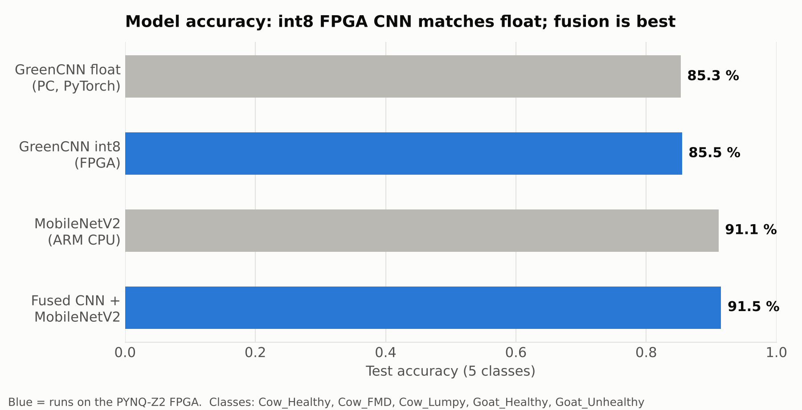
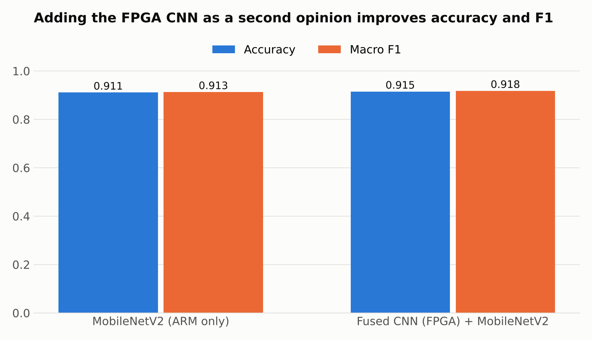
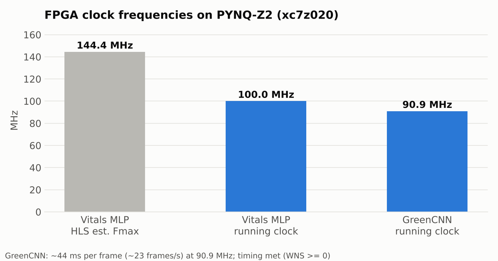

# FPGA Lightweight AI for Cattle Disease Classification (GREEN_VLSI)

Low-power livestock health monitoring on a **PYNQ-Z2 (Xilinx Zynq-7020)** board.
Two neural networks are turned into **FPGA hardware with Vitis HLS**, and a third model runs on the board's ARM CPU. The results are fused into one health decision.

| Part | What it does | Runs on |
|---|---|---|
| **Vitals MLP** (`vitals_mlp`) | Takes 8 sensor readings (temperature, humidity, heart rate, activity, gait asymmetry, respiration rate, …) and gives a health **score** + **alert** flag | FPGA (programmable logic) |
| **GreenCNN** (`green_cnn`) | int8 image classifier for camera frames | FPGA (programmable logic) |
| **MobileNetV2** | Pre-trained image model with a custom 5-class head | ARM Cortex-A9 (OpenCV DNN) |
| **Fusion** | `0.5 × GreenCNN + 0.5 × MobileNetV2`, confidence threshold 0.60 | ARM |

**Classes (5):** `Cow_Healthy`, `Cow_FMD` (foot-and-mouth disease), `Cow_Lumpy` (lumpy skin disease), `Goat_Healthy`, `Goat_Unhealthy`

---

## 1. Results
   





### Demo video

[](https://youtu.be/lldZG0LqKcE)


| Model | Where it runs | Accuracy | Macro F1 |
|---|---|---|---|
| GreenCNN (float, PyTorch) | PC | 0.853 | – |
| **GreenCNN int8** | **FPGA** | **0.855** | – |
| MobileNetV2 | ARM | 0.911 | 0.913 |
| **Fused CNN + MobileNetV2** | **FPGA + ARM** | **0.915** | **0.918** |

- The int8 quantised CNN on the FPGA is as accurate as the float model, so quantisation loses nothing.
- The FPGA C++ model is **bit-exact** with the Python model: 16/16 test images give identical outputs.
- The CNN accelerator runs at **90.9 MHz**, about **44 ms per frame**.
- The vitals MLP synthesises with an estimated **Fmax of 144 MHz** and runs at 100 MHz.
- Classical ML baselines (Logistic Regression, SVM-RBF, Random Forest, KNN) were trained for comparison. The fused system is about 7 points above the best ML model (SVM).

Full numbers: `training/outputs/comparison.csv` and `training/outputs/comparison.png`. Confusion matrices are in `training/outputs/*/cm_*.png`.

---
## Dataset

| Classes | Source |
|---|---|
| Cow_Healthy, Cow_FMD, Cow_Lumpy | [Cattle Diseases Datasets – Kaggle](https://www.kaggle.com/datasets/devang03mgr/cattle-diseases-datasets) |
| Goat_Healthy, Goat_Unhealthy | [Healthy and Unhealthy Goat Images – Kaggle](https://www.kaggle.com/datasets/kartikeybartwal/dataset) |

The images are not included in this repo. Download both datasets, then run
`python training/step0_build_dataset.py` to build the 5-class dataset (70/15/15 split in step 2).
## 2. Repository layout

```
.
├── hls/                    Vitals MLP – HLS C++ source
│   ├── vitals_mlp.cpp        top function (8 inputs → 8 hidden ReLU → score, alert)
│   ├── vitals_mlp.h          weights + interface
│   └── tb_vitals_mlp.cpp     C testbench (4 test cases)
├── vivado/green_vlsi/      Vitals MLP – Vivado block design (Zynq PS + vitals_mlp IP, AXI-Lite)
├── overlay/                Vitals MLP – files for the board
│   ├── green_vlsi.bit        bitstream
│   ├── green_vlsi.hwh        hardware handoff (needed by PYNQ)
│   └── test_overlay.py       board test (expects 4 × PASS)
├── pynq/                   original copy of test_overlay.py
│
├── hls_cnn/                CNN – HLS C++ source
│   ├── green_cnn.cpp / .h    int8 CNN accelerator (AXI-Lite control + AXI master to DDR)
│   ├── cnn_weights.h         trained int8 weights (generated by training/step6)
│   ├── tb_green_cnn.cpp      C testbench (16 images, bit-exact check)
│   └── cnn_test_vectors.h    test images + expected outputs
├── cnn_vivado/green_cnn/   CNN – Vivado block design (Zynq PS + green_cnn IP, HP0 port to DDR)
├── cnn_overlay/            CNN – everything the board needs
│   ├── green_cnn.bit / .hwh  bitstream + hardware handoff
│   ├── cnn_int8_params.npz   int8 weights / scales
│   ├── cnn_meta.json         layer + class info
│   ├── cnn_test_vectors.npz  known inputs/outputs for checking the FPGA
│   ├── mobilenetv2.onnx      MobileNetV2 model for the ARM
│   ├── mnv2_meta.json        MobileNetV2 preprocessing + classes
│   ├── fusion.json           fusion weight + threshold
│   ├── test_fpga_cnn.py      step 1: checks the FPGA CNN against test vectors
│   ├── test_camera.py        step 2: checks the USB camera
│   └── livestock_cam.py      step 3: live app (camera → FPGA CNN + MobileNetV2 → fused label)
│
├── training/               Python training pipeline (PC)
│   ├── config.py, common.py, cnn_model.py
│   ├── step0_build_dataset.py … step8_fusion.py
│   ├── run_all.bat           runs all steps in order
│   ├── predict.py            predict a single image on the PC
│   ├── requirements.txt
│   └── outputs/              plots, metrics, reports, confusion matrices
│
├── MANUAL_STEPS.md         detailed GUI walkthrough (Vitis HLS + Vivado + board)
└── chip_name.txt
```

**Not included (too large or machine-specific):** the image dataset, the Python virtual environment, HLS/Vivado build folders (`solution1/`, `*.runs/`, `*.cache/`, `*.gen/` …), and trained PyTorch checkpoints.

---

## 3. Tools and hardware

| Item | Version / part |
|---|---|
| Board | TUL **PYNQ-Z2**, FPGA `xc7z020clg400-1` |
| HLS | AMD **Vitis HLS 2023.2** |
| FPGA design | AMD **Vivado 2023.2** (with the PYNQ-Z2 board files installed) |
| Board image | PYNQ (Jupyter at `http://192.168.2.99:9090`, password `xilinx`) |
| PC Python | **Python 3.11** (venv) – see `training/requirements.txt` |
| Camera | USB webcam plugged into the PYNQ-Z2 |

---

## 4. Quick start: run on the board (no rebuilding)

The bitstreams are already in the repo, so you only need the board.

### 4.1 Connect the board
1. Put the PYNQ SD card in the board and set the boot jumper to **SD**.
2. Connect Ethernet from the board to your PC and power it on. Wait about 1 minute.
3. Give your PC's Ethernet adapter a static IP `192.168.2.1`, mask `255.255.255.0`.
4. Open `http://192.168.2.99:9090` in a browser. The password is `xilinx`.

### 4.2 Vitals MLP
1. In Jupyter, create a folder `green_vlsi` and upload the 3 files from `overlay/`.
2. Open a new Python 3 notebook, paste in `test_overlay.py` and run it.
3. ✅ Expected output: the IP list includes `vitals_mlp_0`, the register map is printed, and you get **4 × PASS**.

The 4 test cases are healthy goat, fever + fast heart rate, lame + lethargic, and mild heat stress.

### 4.3 Livestock CNN
1. Create a folder `green_cnn` and upload **all** files from `cnn_overlay/`.
2. Plug the USB camera into the board.
3. Open **New → Terminal**, `cd` into the folder, and run the three scripts in order:
   ```bash
   python3 test_fpga_cnn.py      # FPGA results must match the test vectors
   python3 test_camera.py        # camera must open and grab frames
   python3 livestock_cam.py      # live classification
   ```
   Use `python3 livestock_cam.py --help` to see all options.

### 4.4 Try the app on a PC, without the board
The FPGA is replaced by a bit-exact numpy model:
```bat
cd cnn_overlay
python livestock_cam.py --sim --display window          (press q to quit)
python livestock_cam.py --sim --image "C:\path\to\cow.jpg"
```

---

## 5. Rebuild everything from scratch

### Step 1: Train the models (PC)
```bat
cd training
py -3.11 -m venv .venv
.venv\Scripts\activate
pip install -r requirements.txt
```

| Step | Command | Output |
|---|---|---|
| 0 | `python step0_build_dataset.py` | builds the 5-class cow + goat dataset (copies; originals untouched) |
| 1 | `python step1_check_dataset.py` | class counts, `outputs/sample_grid.png` |
| 2 | `python step2_prepare_data.py` | 70 / 15 / 15 train/val/test split + image caches |
| 3 | `python step3_train_ml.py` | ML baselines: LogReg, SVM, Random Forest, KNN |
| 4 | `python step4_train_dl.py` | GreenCNN trained from scratch |
| 6 | `python step6_export_hls.py` | int8 weights → `hls_export/cnn_weights.h` + `cnn_test_vectors.h` |
| 7 | `python step7_train_mobilenetv2.py` | MobileNetV2 + custom head → `deploy/mobilenetv2.onnx` |
| 8 | `python step8_fusion.py` | best CNN/MobileNetV2 mix → `deploy/fusion.json` |
| 5 | `python step5_compare.py` | `outputs/comparison.png` (all models) |

Or run everything with `run_all.bat`. Training takes about 1.5–2.5 hours on a CPU.

If `step0` can't find the goat images, pass the folders yourself:
`python step0_build_dataset.py --goat-healthy "FOLDER" --goat-unhealthy "FOLDER"`

### Step 2: HLS: C++ → hardware IP (Vitis HLS 2023.2)

Do this once for each accelerator:

| Setting | Vitals MLP | CNN |
|---|---|---|
| Project name | `vitals_mlp_prj` | `green_cnn_prj` |
| Design files | `hls/vitals_mlp.cpp`, `vitals_mlp.h` | `hls_cnn/green_cnn.cpp`, `green_cnn.h`, `cnn_weights.h` |
| Testbench | `hls/tb_vitals_mlp.cpp` | `hls_cnn/tb_green_cnn.cpp`, `cnn_test_vectors.h` |
| Top function | `vitals_mlp` | `green_cnn` |
| Period / part | `10` ns / `xc7z020clg400-1` | `10` ns / `xc7z020clg400-1` |
| Flow target | Vivado IP Flow Target | Vivado IP Flow Target |

Then:
1. **Run C Simulation.** Vitals: 4 × PASS. CNN: 16/16 **BIT-EXACT**, `*** ALL TESTS PASSED ***`.
2. **Run C Synthesis.** Check that resource use is below 100 % and note the Fmax.
3. **Export RTL** (IP catalog). The IP appears in `…/solution1/impl/ip`.

### Step 3: Vivado: IP → bitstream (Vivado 2023.2)
1. Open `vivado/green_vlsi/green_vlsi.xpr` (or `cnn_vivado/green_cnn/green_cnn.xpr`).
2. **Settings → IP → Repository → +** and add the `solution1/impl/ip` folder from Step 2. The HLS IP isn't stored in this repo, so it must be re-exported and re-added.
3. Open the block design. It contains:
   - **Vitals:** ZYNQ7 PS → AXI interconnect → `vitals_mlp_0` (AXI-Lite), plus a processor reset block.
   - **CNN:** ZYNQ7 PS with the **HP0** slave port enabled → AXI memory interconnect → `green_cnn_0` (AXI-Lite control + AXI master reading images from DDR).
4. **Validate Design (F6) → Create HDL Wrapper → Generate Bitstream.**
5. Check that timing is met (**WNS ≥ 0**). The CNN design was closed at 90 MHz (90.909 MHz actual).
6. Copy the two board files, giving both the **same base name**:
   - `<proj>.runs/impl_1/<name>_wrapper.bit` → `<name>.bit`
   - `<proj>.gen/sources_1/bd/<name>/hw_handoff/<name>.hwh`

### Step 4: Run on the board
Follow section 4.

For a click-by-click version of steps 2–4, see **`MANUAL_STEPS.md`**.

---

## 6. How the hardware works

### Vitals MLP
- **Inputs (AXI-Lite registers):** `temp_x10`, `humidity`, `heart_rate`, `activity`, `gait_asym`, `resp_rate`, `feed_min`, `spare_in`, `threshold`
- **Network:** 8 inputs → 8 hidden neurons (ReLU) → 1 output, fully unrolled, so it finishes in a few clock cycles.
- **Hidden neurons** each detect one condition: fever, hypothermia, tachycardia, bradycardia, heat stress, lethargy, lameness and tachypnea.
- **Outputs:** `score` (weighted sum) and `alert` (`score > threshold`).
- The current weights are set by hand from veterinary threshold values. You can swap in trained int8 weights in `vitals_mlp.h` without changing the hardware.

### GreenCNN accelerator
- The ARM writes the image to DDR. The CNN IP reads it through the **AXI master (`m_axi gmem`) on the HP0 port** and returns 5 class scores through **AXI-Lite (`s_axilite CTRL`)**.
- All weights are **int8** and compiled into on-chip memory (`cnn_weights.h`).
- In parallel, the ARM runs MobileNetV2 (112 × 112 input). `livestock_cam.py` fuses both results 50/50 and only shows a label when confidence is ≥ 0.60.

---

## 7. Future work
- **Cattle weight estimation** with a top-view depth/stereo camera (for example Intel RealSense D455 or ZED 2i) and volume-to-weight regression. This is not implemented in this repo yet.
- Train the vitals MLP on real sensor data, and connect real sensors (for example an ESP32 node) to the board.
- Run MobileNetV2 on the FPGA as well, so the ARM is free.

---

## 8. Author
**Adithya Subash** – GREEN_VLSI project
